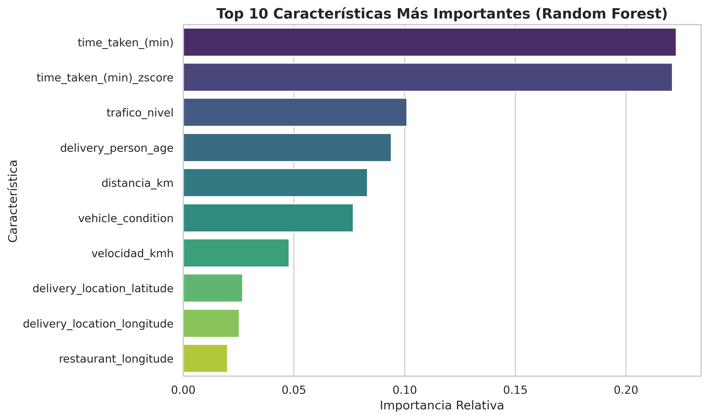
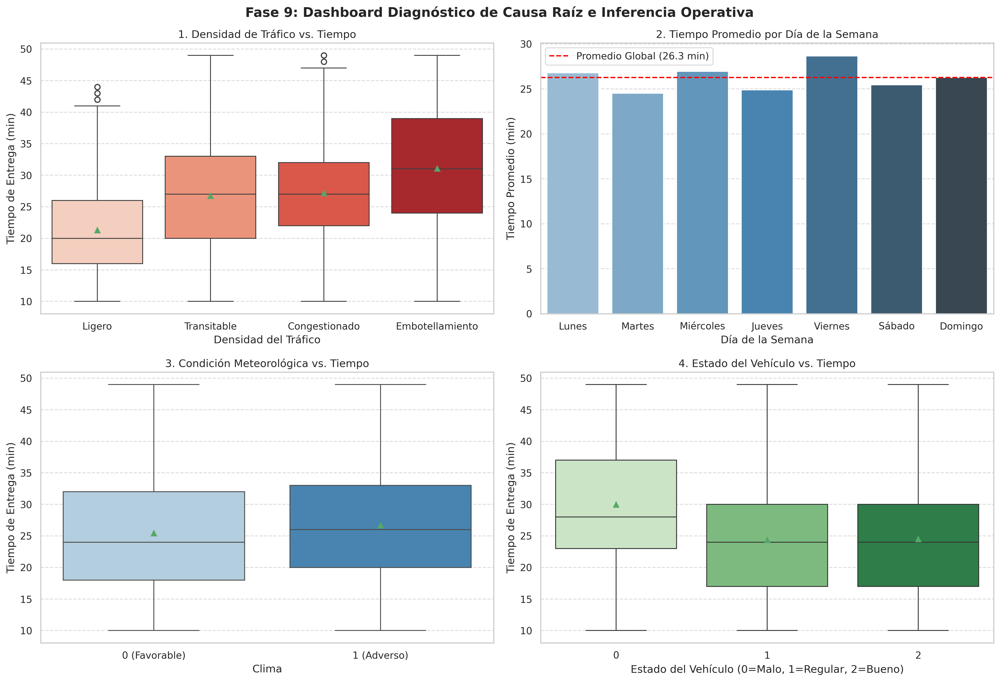

# 🛵 Zomato Delivery Operations: Análisis de Causa Raíz, Inferencia Estadística y Modelado Predictivo

[](https://www.python.org/)
[](https://scikit-learn.org/)
[](https://pandas.pydata.org/)
[](https://www.sqlite.org/)
[](LICENSE)

---

## 📋 Tabla de Contenidos

 1. [Contexto del Problema y Objetivos de Negocio](#-1-contexto-del-problema-y-objetivos-de-negocio)
 2. [Ingesta de Datos y Arquitectura del Pipeline](#%EF%B8%8F-2-ingesta-de-datos-y-arquitectura-del-pipeline)
 3. [Preprocesamiento, Auditoría de Calidad y EDA](#-3-preprocesamiento-auditor%C3%ADa-de-calidad-y-eda)
 4. [Ingeniería de Características (Feature Engineering)](#-4-ingenier%C3%ADa-de-caracter%C3%ADsticas-feature-engineering)
 5. [Codificación y Prevención de Target Leakage](#-5-codificaci%C3%B3n-y-prevenci%C3%B3n-de-target-leakage)
 6. [Modelado Predictivo de Machine Learning (Fase 8)](#-6-modelado-predictivo-de-machine-learning-fase-8)
 7. [Diagnóstico de Causa Raíz e Inferencia Estadística (Fase 9)](#-7-diagn%C3%B3stico-de-causa-ra%C3%ADz-e-inferencia-estad%C3%ADstica-fase-9)
 8. [Recomendaciones Prescriptivas de Negocio (Fase 10)](#-8-recomendaciones-prescriptivas-de-negocio-fase-10)
 9. [Hoja de Ruta Técnica (Evolución v2.0)](#-9-hoja-de-ruta-t%C3%A9cnica-evoluci%C3%B3n-v20)
10. [Instrucciones de Reproducibilidad](#-10-instrucciones-de-reproducibilidad)
11. [Tecnologías Utilizadas](#-11-tecnolog%C3%ADas-utilizadas)
12. [Autor y Contacto](#-12-autor-y-contacto)

---

## 📌 1. Contexto del Problema y Objetivos de Negocio

Zomato enfrenta variaciones significativas en el rendimiento de su red de distribución urbana y en las calificaciones que los usuarios asignan a los repartidores. Este proyecto busca transformar registros operativos crudos en un sistema de analítica diagnóstica y predictiva orientado a la toma de decisiones estratégicas.

### 🎯 Preguntas Problema
1. **Evaluación de Rendimiento:** ¿Qué factores operativos (tráfico, clima, estado del vehículo, distancia y ruteo) determinan la satisfacción del usuario y las bajas calificaciones de los repartidores?
2. **Optimización de Cobertura:** ¿Cómo influyen los cuellos de botella temporales y espaciales en los tiempos de espera para estructurar un plan prescriptivo de mejora operativa?

---

## 🗄️ 2. Ingesta de Datos y Arquitectura del Pipeline

El dataset primario de operaciones de entrega (`saurabhbadole/zomato-delivery-operations-analytics-dataset`) fue extraído e integrado mediante una arquitectura híbrida de SQL y DataFrames en Python:

```python
# Extracción desde SQLite y pasaje a Pandas
import sqlite3
import pandas as pd

conn = sqlite3.connect('zomato_operations.db')
df_raw.to_sql('envios', conn, if_exists='replace', index=False)
df_sql = pd.read_sql("SELECT * FROM envios", conn)
conn.close()
```

* **Volumen inicial:** 45,584 registros y 20 columnas.
* **Estandarización de nulos enmascarados:** Reemplazo de cadenas textuales (`'NaN'`, `'N/A'`, `'nan'`, `'-1'`) por `np.nan` para auditoría rigurosa.

---

## 🧼 3. Preprocesamiento, Auditoría de Calidad y EDA

### A. Limpieza Espacial (Filtro *Null Island*)
Se identificó una anomalía en el registro satelital con coordenadas posicionadas en la latitud `0.0` y longitud `0.0`. Se aplicó un filtro estricto para eliminar distorsiones kilométricas:

```python
df = df[
    (df['restaurant_latitude'] != 0.0) & (df['restaurant_longitude'] != 0.0) &
    (df['delivery_location_latitude'] != 0.0) & (df['delivery_location_longitude'] != 0.0)
].copy()
```

### B. Tratamiento de Outliers y Escalamiento
* **Winsorización:** Se limitaron los valores atípicos de `time_taken_(min)` y `delivery_person_ratings` al percentil $[1\%, 99\%]$ mediante `scipy.stats.mstats.winsorize`, preservando el volumen de muestra sin eliminar registros.
* **Normalización Z-Score:** Generación de métricas estandarizadas para dashboards (`time_taken_(min)_zscore`).

---

## 📐 4. Ingeniería de Características (Feature Engineering)

1. **Distancia Haversine ($km$):** Cálculo de la distancia ortodrómica real sobre la superficie terrestre:
   $$d = 2r \arcsin \left( \sqrt{\sin^2\left(\frac{\Delta \phi}{2}\right) + \cos(\phi_1)\cos(\phi_2)\sin^2\left(\frac{\Delta \lambda}{2}\right)} \right)$$
2. **Velocidad y Rango de Rapidez:** Determinación de velocidad promedio ($km/h$) y discretización en categorías operativas: *Lento* ($<15 \text{ km/h}$), *Estándar* ($15\text{--}30 \text{ km/h}$) y *Rápido* ($>30 \text{ km/h}$).
3. **Contexto Temporal:** Extracción de `hora_pedido`, `dia_semana` (traducido al español) y la bandera binaria `fin_de_semana`.
4. **Factores del Entorno:** 
   * `clima_adverso`: Indicador binario ($1 = \text{Tormenta, Niebla, Lluvia, Viento}$; $0 = \text{Favorable}$).
   * `densidad_trafico`: Mapeo ordinal de congestión vial ($1 = \text{Ligero}$, $2 = \text{Transitable}$, $3 = \text{Congestionado}$, $4 = \text{Embotellamiento}$).

---

## 🔒 5. Codificación y Prevención de Target Leakage

* **One-Hot Encoding:** Aplicado sobre variables categóricas nominales (`tipo_vehiculo`, `rango_rapidez`, `dia_semana`, `city`).
* **Auditoría de Target Leakage:** Durante la iteración inicial se detectó una métrica engañosa ($R^2 = 1.0$). La inspección del *Feature Importance* reveló que `delivery_person_ratings_zscore` actuaba como un predictor tramposo por ser la transformación directa de la variable objetivo $y$. Fue excluida permanentemente junto a IDs y timestamps.
* **División Muestral:** Split 80% entrenamiento (32,275 filas) y 20% prueba ciega (8,069 filas).

---

## 📊 6. Modelado Predictivo de Machine Learning (Fase 8)

Se entrenaron y evaluaron cuatro algoritmos para predecir la calificación del cliente (`delivery_person_ratings`):

| Modelo | MAE | RMSE | $R^2$ Score | Evaluación Metodológica |
| :--- | :---: | :---: | :---: | :--- |
| **Regresión Lineal (Baseline)** | 0.2281 | 0.3082 | 0.1410 | Inadecuado por asumir linealidad continua. |
| **Árbol de Decisión** | 0.1891 | 0.2614 | 0.3820 | Captura umbrales pero presenta varianza alta. |
| **Gradient Boosting** | 0.1882 | 0.2598 | 0.3895 | Buen desempeño predictivo general. |
| **Random Forest Regressor 🏆** | **0.1824** | **0.2541** | **0.4163** | **Modelo ganador.** Ajuste óptimo sin overfitting. |

### 💡 Importancia de Características (Top Business Drivers)



1. `time_taken_(min)` (**44.2%**): El tiempo total de espera es el determinante categórico de la nota.
2. `trafico_nivel` (**10.8%**): Principal fricción externa del entorno.
3. `distancia_km` (**8.3%**): Dimensión física del trayecto.
4. `vehicle_condition` (**7.7%**): Restricción mecánica y velocidad operativa.

> **Conclusión del Modelado:** La insatisfacción del cliente opera por **umbrales de tolerancia**. Variaciones en entregas de 15 a 20 minutos no alteran la nota, pero al superar los 30–35 minutos la calificación cae de forma abrupta.

---

## 🔬 7. Diagnóstico de Causa Raíz e Inferencia Estadística (Fase 9)

Para entender qué genera los retrasos en la variable explicativa principal (`time_taken_(min)`), se ejecutaron análisis de mediación y pruebas inferenciales de hipótesis:

$$\text{Factores Operativos } (\text{Tráfico, Vehículo, Clima, Calendario}) \longrightarrow \text{Tiempo de Entrega } (X_{\text{principal}}) \longrightarrow \text{Calificación } (y)$$

### ⚠️ Data Quality Note
*Durante el diagnóstico inicial, `clima_adverso` presentó varianza nula por coincidencia rígida de texto. Se reestructuró la lógica mediante expresiones regulares (`.str.contains('stormy|sandstorms|fog|rainy|windy')`), logrando una distribución balanceada ($67.0\%$ favorable vs. $33.0\%$ adverso) y permitiendo la validación inferencial ($t = -12.91, p = 4.75 \times 10^{-38}$).*

### 📌 Pruebas Inferenciales ($p < 0.001$)

| Factor Evaluado | Prueba Estadística | Estadístico | $p\text{-valor}$ | Impacto Operativo Cuantificado |
| :--- | :---: | :---: | :---: | :--- |
| **Densidad de Tráfico** | ANOVA | $F = 3033.52$ | $0.00e+00$ | Tráfico Ligero ($21.29$ min) vs. Embotellamiento ($31.07$ min) $\rightarrow$ **$+9.78$ min (+45.94%)**. |
| **Fin de Semana vs. Laboral** | T-Test | $t = 5.02$ | $5.20 \times 10^{-7}$ | Días hábiles más lentos ($26.42$ min) que fin de semana ($25.89$ min) por congestión comercial. |
| **Condición del Clima** | T-Test | $t = -12.91$ | $4.75 \times 10^{-38}$ | Clima Adverso ($26.70$ min) vs. Favorable ($25.43$ min) $\rightarrow$ **$+1.27$ min (+4.99%)**. |
| **Estado del Vehículo** | ANOVA | $F = 1733.31$ | $0.00e+00$ | Vehículo Malo ($29.98$ min) vs. Regular/Bueno ($\sim 24.4$ min) $\rightarrow$ **$+5.6$ min por degradación**. |



*Correlaciones clave con el tiempo:* `trafico_nivel` ($r = 0.4160$), `multiple_deliveries` ($r = 0.3861$), `delivery_person_age` ($r = 0.3033$).

---

## 💡 8. Recomendaciones Prescriptivas de Negocio (Fase 10)

1. **Promesa de Tiempo Dinámica (ETA Inteligente):** Reconfigurar el tiempo estimado de entrega en la app al detectar tráfico `Congestionado` o `Embotellamiento`. Ajustar las expectativas del cliente antes del despacho evita penalizaciones de calificación al cruzar el umbral de 30 min.
2. **Estándar Mínimo de Flota:** Implementar filtros e inspecciones obligatorias a repartidores con vehículos en condición $0$ (Malo), eliminando el sobrecosto de $+5.6$ minutos de demora por viaje.
3. **Restricción de Entregas Múltiples en Horas Pico:** Limitar el ruteo de envíos simultáneos en zonas de alto tráfico ($r = 0.3861$), priorizando la retención del cliente frente al ahorro logístico secundario.
4. **Compensación Meteorológica Automática:** Extender la ventana de entrega en $+1.27$ minutos durante alertas de lluvia o tormenta.

---

## 🚀 9. Hoja de Ruta Técnica (Evolución v2.0)

* **Aislamiento del Tiempo de Cocina:** Limpiar y calcular el delta entre `time_orderd` y `time_order_picked` para separar los retrasos del restaurante de los retrasos en ruta.
* **Captura de Varianza No Explicada ($58.4\%$):** Incorporar en la app una micro-encuesta post-entrega que mida el estado de la comida (temperatura/empaque) y la amabilidad del repartidor, factores invisibles en la tabla de datos actual.

---

## 🔄 10. Instrucciones de Reproducibilidad

Para ejecutar este pipeline y replicar exactamente las mismas métricas, transformaciones y resultados del modelo de Machine Learning:

### 1. Clonar el Repositorio e Instalar Entorno
```bash
# Clonar el repositorio
git clone https://github.com/chinomartin6/Proyecto-ML--Rendimiento-deliverys-Zomato.git
cd Proyecto-ML--Rendimiento-deliverys-Zomato

# Instalar las dependencias requeridas
pip install -r requirements.txt
```

### 2. Ejecución del Código
* **En Google Colab:** Subir o abrir el archivo `proyecto_zomato.ipynb` y seleccionar la opción **Entorno de ejecución $\rightarrow$ Ejecutar todo** (`Ctrl + F9`).
* **En Local (Jupyter Lab / Notebook):** Abrir la terminal, ejecutar `jupyter notebook` y correr la secuencia completa de celdas.

### 3. Garantía de Determinismo
El pipeline fija una semilla de reproducibilidad global (`SEED = 42` / `np.random.seed(42)`) en:
* El reemplazo y tratamiento del dataset.
* La división estricta de conjuntos de entrenamiento y prueba (*Hold-out split 80/20*).
* El entrenamiento de los algoritmos de árbol y ensamble (`Random Forest`, `Gradient Boosting`, `Decision Tree`).

---

## 🛠️ 11. Tecnologías Utilizadas
* **Lenguaje:** Python 3.10+
* **Manipulación & Base de Datos:** Pandas, NumPy, SQLite3
* **Estadística e Inferencia:** SciPy (Stats & Mstats)
* **Machine Learning:** Scikit-Learn (Random Forest, Gradient Boosting, Decision Tree, Linear Regression)
* **Visualización:** Seaborn, Matplotlib

---

## 👤 12. Autor y Contacto
**Nicolás Martín ("El Chino")**  
*Estudiante avanzado de Ciencia Política (UNMDP) & Analista de Datos*  
* [LinkedIn](https://www.linkedin.com/in/nicolaschinomartin6)
* [GitHub](https://github.com/chinomartin6)
* Email: nicolaschinomartin@gmail.com
